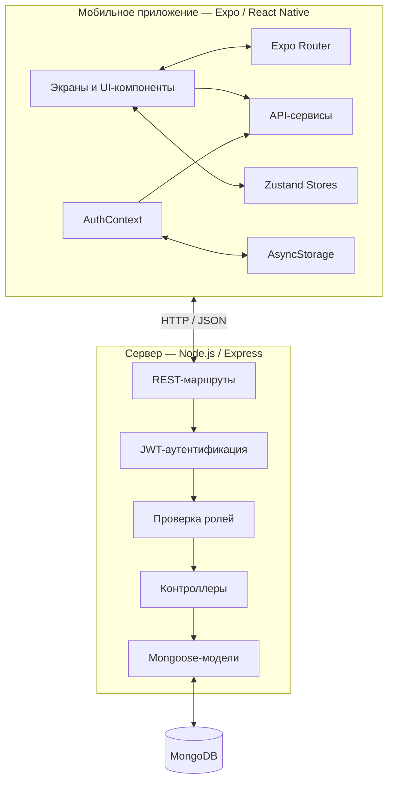

<div align="center">

# Trainix

### Тренировки. Питание. Прогресс.

Мобильное приложение для учёта тренировок и питания с поддержкой программ от тренеров.

**React Native · Expo · TypeScript · Node.js · Express · MongoDB**

[](https://reactnative.dev/)
[](https://expo.dev/)
[](https://www.typescriptlang.org/)
[](https://nodejs.org/)
[](https://expressjs.com/)
[](https://www.mongodb.com/)

[Возможности](#-возможности) · [Архитектура](#-архитектура) · [Технологии](#-технологический-стек) · [Установка](#-установка-и-запуск) · [API](#-обзор-api)

</div>

---

## 📌 О проекте

**Trainix** — мобильное приложение для комплексного учёта физической активности и питания. Оно объединяет дневник тренировок, контроль калорий и макронутриентов, персональную статистику и программы, подготовленные тренерами.

Проект построен по клиент-серверной архитектуре: мобильное приложение взаимодействует с REST API, сервер обрабатывает запросы и бизнес-логику, а MongoDB используется для хранения данных.

Репозиторий состоит из двух самостоятельных частей:

- **`mobile/`** — мобильное приложение на React Native, Expo и TypeScript.
- **`backend/`** — серверное приложение на Node.js, Express и Mongoose.

Проект разработан в рамках дипломной работы и демонстрирует практические навыки создания full-stack приложения: от мобильного интерфейса до серверной логики и проектирования базы данных.

## ✨ Возможности

### 🏋️ Учёт тренировок

- Создание, редактирование и удаление тренировок.
- Добавление упражнений в тренировку и управление их порядком.
- Запись подходов, количества повторений и рабочего веса.
- Использование предыдущих результатов упражнения при создании новой тренировки.
- Учёт продолжительности и статуса тренировки.
- Просмотр недельной статистики и динамики результатов по упражнениям.

### 🥗 Учёт питания

- Дневник питания с разделением на завтрак, обед, ужин и перекусы.
- Добавление продуктов с указанием массы в граммах.
- Расчёт калорий, белков, жиров и углеводов на основе пищевой ценности продукта.
- Отображение потреблённых, целевых и оставшихся значений КБЖУ.
- Просмотр записей питания за выбранную дату.
- Ограничение на создание нескольких приёмов пищи одного типа за день для одного пользователя.

### 👤 Профиль и главная панель

- Регистрация и авторизация по электронной почте и паролю.
- Хранение персональных параметров: рост, вес, уровень активности и цель тренировок.
- Отображение прогресса питания и тренировочной активности.
- Просмотр последней тренировки и недельной статистики.
- Сохранение пользовательской сессии между запусками приложения.

### 🧑‍🏫 Тренеры и программы

- Просмотр профилей тренеров.
- Каталог тренировочных программ и планов питания.
- Создание и управление программами со структурой по дням.
- Покупка программы и получение доступа к её содержимому.
- Подача заявки на получение роли тренера.
- Рассмотрение заявок администраторами.
- Возможность оставить оценку от 1 до 5 и текстовый отзыв после покупки программы.

> **Примечание:** в проекте также присутствуют модули с тестовыми данными. Наличие реализации в исходном коде не означает, что каждый сценарий прошёл полноценное тестирование в production-среде.

## 🧰 Технологический стек

| Область | Технологии |
|---|---|
| Мобильная разработка | React Native, Expo, TypeScript |
| Навигация | Expo Router, React Navigation |
| Интерфейс и анимации | React Native Components, Expo Blur, Expo Linear Gradient, Expo Haptics |
| Управление состоянием | React Context, Zustand |
| Локальное хранение | AsyncStorage |
| HTTP-запросы | Fetch API |
| Серверная платформа | Node.js, JavaScript ES Modules |
| Backend-фреймворк | Express 5 |
| База данных | MongoDB, Mongoose |
| Аутентификация | JSON Web Tokens, bcryptjs |
| Конфигурация | dotenv |
| Междоменные запросы | CORS |
| Работа с медиа | Cloudinary SDK (конфигурация) |

Версии зависимостей зафиксированы в файлах `mobile/package-lock.json` и `backend/package-lock.json`.

## 🏗️ Архитектура

Trainix использует многоуровневую клиент-серверную архитектуру.



### Жизненный цикл запроса

1. Пользователь выполняет действие на одном из экранов мобильного приложения.
2. Соответствующий сервис отправляет HTTP-запрос на настроенный адрес API.
3. API-клиент получает сохранённый JWT и добавляет его в заголовок `Authorization: Bearer <token>`, если запрос требует авторизации.
4. Express передаёт защищённые запросы через middleware аутентификации.
5. Middleware проверки ролей определяет, имеет ли пользователь необходимые права.
6. Контроллер обрабатывает запрос, выполняет бизнес-логику и взаимодействует с Mongoose-моделями.
7. Сервер возвращает JSON-ответ мобильному приложению.

### Слои серверной части

| Слой | Назначение |
|---|---|
| Routes | Определение HTTP-методов, URL и цепочек middleware |
| Middleware | Проверка JWT и разграничение доступа по ролям |
| Controllers | Обработка запросов и реализация бизнес-логики |
| Models | Описание схем MongoDB, валидаций и индексов |
| Config | Настройка переменных окружения, подключения к БД и Cloudinary SDK |

### Аутентификация и авторизация

- Пароли хешируются с помощью **bcryptjs** перед сохранением.
- Сервер выдаёт JWT со сроком действия 30 дней.
- Для защищённых маршрутов используется заголовок `Authorization: Bearer <token>`.
- Middleware аутентификации проверяет токен и загружает текущего пользователя.
- Middleware ролей поддерживает роли `user`, `trainer` и `admin`.

## 📁 Структура проекта

```text
TrainixDiploma/
├── backend/
│   ├── src/
│   │   ├── config/          # Переменные окружения, БД и Cloudinary
│   │   ├── controllers/     # Обработчики запросов и бизнес-логика
│   │   ├── middleware/      # JWT-аутентификация и проверка ролей
│   │   ├── models/          # Mongoose-схемы
│   │   ├── routes/          # Маршруты REST API
│   │   ├── seed/            # Начальные данные продуктов и упражнений
│   │   ├── app.js           # Настройка Express и подключение маршрутов
│   │   └── server.js        # Подключение к БД и запуск сервера
│   ├── package.json
│   └── package-lock.json
│
└── mobile/
    ├── app/                 # Экраны и навигация Expo Router
    │   ├── (auth)/          # Регистрация и авторизация
    │   ├── (tabs)/          # Главная, тренировки, питание, тренеры, профиль
    │   ├── nutrition/       # Сценарии работы с питанием
    │   ├── plans/           # Просмотр программ тренеров
    │   ├── profile/         # Профиль и приобретённые программы
    │   ├── reviews/         # Отзывы о тренерах
    │   ├── trainer-panel/   # Управление программами тренера
    │   ├── trainers/        # Страницы тренеров
    │   └── workouts/        # Создание и просмотр тренировок
    ├── components/          # Переиспользуемые UI-компоненты
    ├── constants/           # API URL, цвета, отступы и типографика
    ├── contexts/            # Контекст авторизации
    ├── data/                # Модули тестовых данных
    ├── hooks/               # Пользовательские React-хуки
    ├── lib/                 # Общие утилиты и работа с хранилищем
    ├── services/            # Сервисы взаимодействия с API
    ├── store/               # Zustand-хранилища
    ├── types/               # TypeScript-типы
    ├── utils/               # Валидация, форматирование и расчёты
    ├── app.json
    ├── package.json
    └── package-lock.json
```

## 🚀 Установка и запуск

### Необходимое программное обеспечение

- [Node.js](https://nodejs.org/) и npm.
- [MongoDB](https://www.mongodb.com/) — локально или через MongoDB Atlas.
- [Expo Go](https://expo.dev/go) для запуска на совместимом физическом устройстве либо Android/iOS-эмулятор.
- [Git](https://git-scm.com/).

### 1. Клонирование репозитория

```bash
git clone https://github.com/BeneFIT124/TrainixDiploma.git
cd TrainixDiploma
```

### 2. Настройка Backend

Перейдите в директорию сервера и установите зависимости:

```bash
cd backend
npm install
```

Создайте файл `.env` в директории `backend/`:

```env
PORT=3000
NODE_ENV=development

MONGO_URI=mongodb://127.0.0.1:27017/trainix
JWT_SECRET=replace_with_a_long_random_secret
```

#### Переменные окружения Backend

| Переменная | Обязательная | Описание |
|---|---|---|
| `MONGO_URI` | Да | Строка подключения к MongoDB |
| `JWT_SECRET` | Да | Секрет для создания и проверки JWT |
| `PORT` | Нет | Порт сервера, по умолчанию `3000` |
| `NODE_ENV` | Нет | Окружение приложения, по умолчанию `development` |
| `CLOUDINARY_CLOUD_NAME` | Нет* | Название Cloudinary Cloud |
| `CLOUDINARY_API_KEY` | Нет* | API-ключ Cloudinary |
| `CLOUDINARY_API_SECRET` | Нет* | Секретный ключ Cloudinary |

\* Модуль конфигурации Cloudinary читает эти значения, однако в проверенных API-маршрутах не обнаружен подтверждённый сценарий загрузки файлов. Для прохождения проверки обязательных переменных backend эти параметры не требуются.

Запуск сервера в режиме разработки:

```bash
npm run dev
```

Обычный запуск:

```bash
npm start
```

Проверить работоспособность сервера можно запросом:

```http
GET http://localhost:3000/api/health
```

Ожидаемый ответ:

```json
{
  "message": "Success"
}
```

### 3. Настройка Mobile

Откройте второй терминал в корне репозитория:

```bash
cd mobile
npm install
```

Мобильное приложение получает адрес API из переменной `EXPO_PUBLIC_API_BASE_URL`. Если переменная не задана, используется адрес размещённого сервера:

```text
https://trainixapi.onrender.com/api
```

Для подключения к локальному backend создайте файл `mobile/.env`:

```env
EXPO_PUBLIC_API_BASE_URL=http://YOUR_LOCAL_IP:3000/api
```

Замените `YOUR_LOCAL_IP` на локальный IP-адрес компьютера. При запуске на физическом устройстве телефон и компьютер должны находиться в одной сети Wi-Fi.

Для Android Emulator вместо `localhost` используйте `10.0.2.2`:

```env
EXPO_PUBLIC_API_BASE_URL=http://10.0.2.2:3000/api
```

Запустите Expo:

```bash
npx expo start
```

Доступные команды из `package.json`:

```bash
npm run android
npm run ios
npm run web
npm run lint
```

Открыть приложение можно с помощью Expo Go или соответствующего эмулятора.

## 🔌 Обзор API

Все маршруты API подключаются с префиксом `/api`. За исключением проверки работоспособности сервера, маршруты используют JWT-аутентификацию. Для операций тренеров и администраторов дополнительно применяются проверки ролей там, где это предусмотрено маршрутом.

| Ресурс | Базовый путь | Основные операции |
|---|---|---|
| Проверка сервера | `/api/health` | `GET` |
| Авторизация | `/api/auth` | `POST /register`, `POST /login`, `GET /me` |
| Пользователи | `/api/users` | `PUT /profile`, `POST /become-trainer-demo` |
| Продукты | `/api/foods` | `GET /`, `POST /` |
| Приёмы пищи | `/api/meals` | `GET /`, `POST /`, `GET /by-date`, `GET /summary/daily`, `GET /:mealId`, операции с элементами приёма пищи, `DELETE /:mealId` |
| Упражнения | `/api/exercises` | `GET /`, `POST /`, `DELETE /:id` |
| Тренировки | `/api/workouts` | CRUD тренировок и элементов, `GET /exercises/:exerciseId/last-sets` |
| Подходы | `/api/workout-items` | `GET/POST /:itemId/sets`, `PUT/DELETE /:itemId/sets/:setId` |
| Статистика тренировок | `/api/workout-stats` | `GET /summary/weekly`, `GET /exercise-progress/:exerciseId` |
| Главная панель | `/api/dashboard` | `GET /` |
| Профили тренеров | `/api/trainer-profiles` | `GET /`, `GET /:id`, `GET /my`, `POST /`, `PUT /my` и демонстрационная операция с ролью |
| Заявки тренеров | `/api/trainer-applications` | `POST /`, `GET /my`; для администратора: `GET /`, `PUT /:id/review` |
| Тренировочные программы | `/api/workout-plans` | CRUD программ и операции с элементами для тренеров/администраторов |
| Планы питания | `/api/nutrition-plans` | CRUD программ и операции с элементами для тренеров/администраторов |
| Каталог и покупки программ | `/api/plans` | `GET /`, `GET /purchased/my`, `GET /trainer/:trainerProfileId`, `GET /:type/:id`, `POST /:type/:id/purchase` |
| Статистика пользователя | `/api/statistics` | `GET /me` |
| Отзывы | `/api/reviews` | `POST /`, `GET /trainer/:trainerProfileId` |

### Пример: регистрация и авторизация

Регистрация пользователя:

```http
POST /api/auth/register
Content-Type: application/json
```

```json
{
  "username": "alex",
  "email": "alex@example.com",
  "password": "your_password"
}
```

Авторизация:

```http
POST /api/auth/login
Content-Type: application/json
```

```json
{
  "email": "alex@example.com",
  "password": "your_password"
}
```

В ответе сервер возвращает JWT и данные пользователя. Для обращения к защищённым маршрутам необходимо передавать токен:

```http
Authorization: Bearer <token>
```

### Пример: получение дневной статистики питания

```http
GET /api/meals/summary/daily?date=2026-11-08
Authorization: Bearer <token>
```

Ответ содержит информацию о потреблённых калориях и макронутриентах, целевых значениях, остатке на день и количестве записанных приёмов пищи.

> Таблица выше представляет обзор маршрутов, а не полную спецификацию API. Точные поля запросов, форматы ответов и правила валидации описаны в соответствующих файлах маршрутов и контроллеров в `backend/src/`.

## 🧠 Особенности реализации

### Расчёт пищевой ценности

В базе данных пищевая ценность продукта хранится в расчёте на 100 граммов. При добавлении продукта в приём пищи сервер рассчитывает фактические значения с учётом указанной массы.

```text
Коэффициент порции = масса продукта в граммах / 100

Пищевая ценность порции =
    пищевая ценность на 100 г × коэффициент порции
```

Приём пищи хранит агрегированные значения калорий, белков, жиров и углеводов. При удалении элемента его значения вычитаются из общей суммы.

### Целостность данных

- Составной уникальный индекс по пользователю, дате и типу приёма пищи предотвращает создание повторяющихся приёмов одного типа за день.
- Mongoose-схемы задают обязательные поля, допустимые значения и числовые ограничения.
- При работе с пользовательскими тренировками и приёмами пищи запросы учитывают ID авторизованного пользователя.
- Отзыв связан с приобретённой программой; одна покупка не может получить несколько отзывов.

### Сетевое взаимодействие на клиенте

Общий API-клиент мобильного приложения:

- Формирует адреса запросов на основе единой базовой конфигурации API.
- Добавляет Bearer-токен из AsyncStorage для запросов, требующих авторизации.
- Ограничивает время ожидания запроса 25 секундами.
- Повторяет GET-запросы при сетевых ошибках с ограниченным количеством попыток.
- Преобразует ошибки API и сети в понятные приложению сообщения.

### Управление состоянием и пользовательская сессия

Авторизация централизована в `AuthContext`. При запуске приложения контекст восстанавливает сохранённый токен, запрашивает актуальные данные пользователя и очищает недействительную сессию.

Zustand используется для хранения состояния отдельных функциональных модулей, в том числе конструкторов и активных программ. Это позволяет отделить состояние авторизации от состояния отдельных экранов и сценариев приложения.

## 🧪 Тестирование и качество кода

В проверенных `package.json` обнаружены следующие команды:

- **Проверка мобильного приложения:** `npm run lint` из директории `mobile/`.
- **Запуск backend в режиме разработки:** `npm run dev` из директории `backend/`.

Автоматизированный набор unit- или integration-тестов в репозитории при анализе не обнаружен. Поэтому проект не следует считать покрытым автоматическими тестами.

Для ручной проверки основных сценариев можно использовать следующий порядок:

1. Запустить MongoDB и backend.
2. Проверить доступность `GET /api/health`.
3. Зарегистрировать тестового пользователя и выполнить вход.
4. Создать тренировку, добавить упражнение и записать подходы.
5. Добавить приём пищи и продукты, затем проверить дневную сводку КБЖУ.
6. Убедиться, что защищённые маршруты отклоняют запросы без действительного токена.

## ⚙️ Начальное заполнение базы данных

В backend предусмотрена команда для добавления начальных данных:

```bash
cd backend
npm run seed
```

Скрипт добавляет заранее подготовленные продукты и упражнения.

**Важно:** запускайте команду только на тестовой базе данных. Перед добавлением начальных данных скрипт удаляет существующие коллекции `Exercise` и `Food`.

## 🛣️ Возможные направления развития

Ниже перечислены идеи для дальнейшего развития проекта, а не заявленные реализованные функции:

- Добавить автоматизированные unit- и integration-тесты backend.
- Подготовить документацию API с помощью OpenAPI/Swagger.
- Добавить шаблоны `.env.example` для мобильного приложения и сервера.
- Настроить CI для автоматической проверки качества кода и тестов.
- Добавить актуальные скриншоты приложения и демонстрационное видео.
- Завершить и задокументировать сценарий загрузки медиафайлов.

## 👨‍💻 Автор

**BeneFIT124** — автор проекта.

- GitHub: [@BeneFIT124](https://github.com/BeneFIT124)
- Репозиторий: [TrainixDiploma](https://github.com/BeneFIT124/TrainixDiploma)

---

<div align="center">

**Trainix — последовательность сегодня, результат завтра.**

</div>
